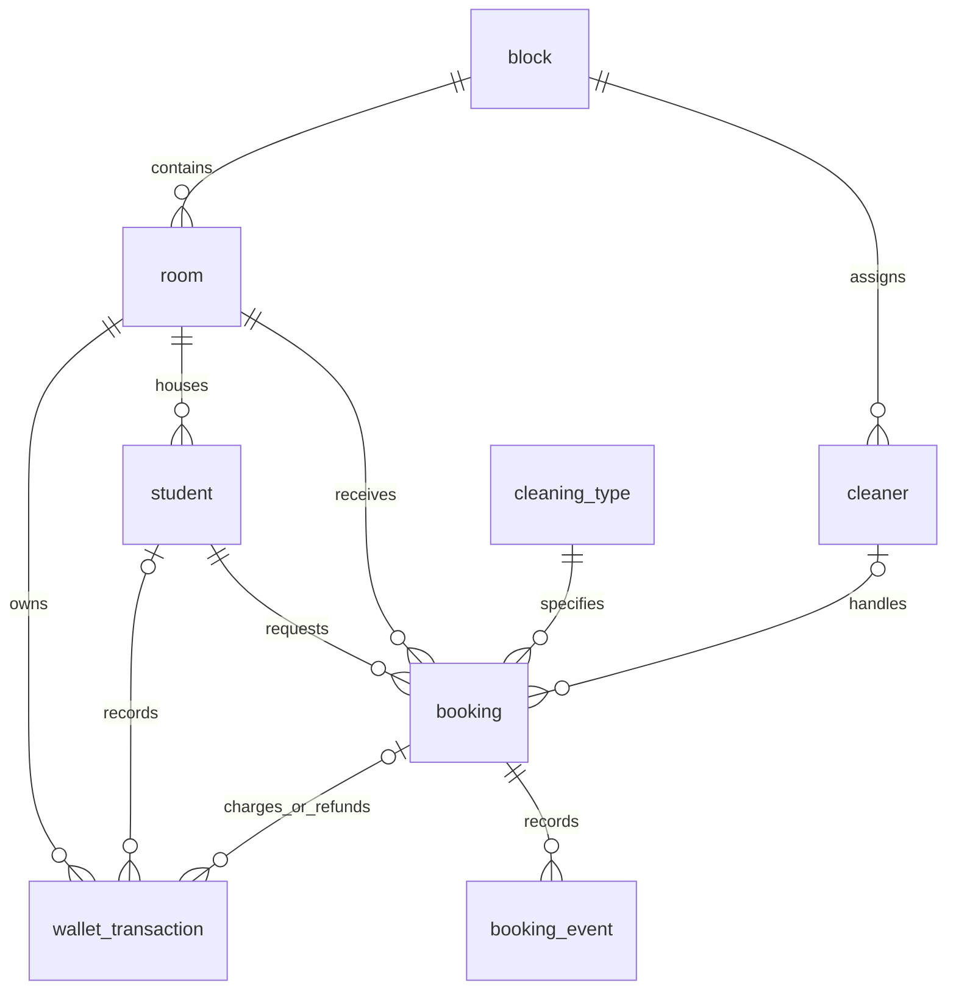

# Database systems presentation guide

The application uses the real SQLite file **`hostel_cleaning.db` in this project folder**. Data is written by Flask using SQL and committed to that file. The UI is not an in-memory mock and does not store student accounts or requests in browser localStorage. LocalStorage only tracks which activity notifications have been read.

## Open two independent sessions

Use these two hostnames to keep the student and staff cookies separate while reading and writing the **same** database:

- Student: **http://127.0.0.1:5000/**
- Staff: **http://localhost:5000/** → Hostel staff → `staff@vit.ac.in` / `pass123`.

In the staff sidebar, open **Database demo**. Keep it beside the student window. It reads live SQLite rows, shows the SELECT query and bound parameters, displays PK/FK links, and checks integrity and wallet reconciliation. Click **Refresh tables** after each step for an immediate update; automatic background updates run every 20 seconds while the page is visible.

## A five-minute demonstration

1. **Create a student and a room.** In the student window, create an account with a unique registration number and an email ending in `vit.ac.in` or `vitstudent.ac.in`. Choose an unused block/room combination, for example T-507 if it is still unused. Use a password of at least 8 characters. In the staff database view, show the new row under Students and Rooms. A new room starts at zero balance. If joining an existing room instead, enter its roommate invite code; a duplicate room is not inserted.
2. **Add ₹250 demo credits.** Open Room wallet and add ₹250. Show the new Wallet ledger entry and the room's balance of ₹250. This is a real stored ledger entry representing demo credits, not a real payment.
3. **Book a Deep clean for ₹150.** Pick any available date/time (tomorrow is fine). Show the new Cleaning requests row, its foreign keys and Scheduled status. Show the Wallet ledger charge of `-150`, a running balance of `100`, and the room balance of ₹100. Room billing shows charged `150`, refunded `0`, net charge `150`.
4. **Cancel and show the refund.** Cancel at least five minutes before the slot. Show the request changing to Cancelled, a new `+150` refund entry, the room returning to ₹250, and Room billing changing to charged `150`, refunded `150`, net charge `0`. Trying to cancel again cannot issue another refund.
5. **Show the cleaning lifecycle.** Book another cleaning. As staff, open All requests. Use **Start cleaning** when within the normal time window, or the clearly labelled **Start now · demo** for a classroom presentation at any time. Then choose **Mark complete**. Show the new Status history rows and updated booking status. Return to the student account and submit a rating; the rating and feedback are saved on the booking, with another history event.
6. **Prove persistence.** Stop the server with Ctrl+C and run `python app.py` again. Reload both browser windows and sign in if needed. Show the same student, room, booking, ledger and feedback rows. Closing a tab or restarting the server does not reset them.

Do not reuse the same email/registration number for repeated demos; uniqueness is intentionally enforced. Registered rooms have a capacity and a private invite code. If the wallet has insufficient credits or a slot overlaps, the booking is rejected without a charge.

The presentation start is an explicit **staff-only local-demo override** of the scheduling time check. It still checks for a cleaner/room already in progress, records the actual timestamp and a demo note, and uses the normal persistent status update. It does not contact or dispatch a real cleaner. Disable it by setting `$env:TIDY_DEMO_MODE = '0'` before starting the server.

## What each action writes

| Action | Stored tables affected |
| --- | --- |
| Create account in a new room | INSERT `room`; INSERT `student` |
| Join an existing room | INSERT `student` referencing the existing `room_id` |
| Add demo credits | UPDATE `room.room_balance`; INSERT `wallet_transaction` |
| Book cleaning | INSERT `booking`; UPDATE `room.room_balance`; INSERT `wallet_transaction`; INSERT `booking_event` |
| Cancel request | UPDATE `booking`; UPDATE `room.room_balance`; INSERT refund in `wallet_transaction`; INSERT `booking_event` |
| Start / complete cleaning | UPDATE `booking.status` / completion timestamp; INSERT `booking_event` |
| Submit feedback | UPDATE `booking.rating` / `feedback`; INSERT `booking_event` |

**Cleaning billing is stored in `booking.amount_charged` and `wallet_transaction`.** `v_room_billing` is a live SQL view joining those records to rooms, blocks and services. `v_room_statement` computes the running balance with a window function. Views are queried dynamically; they are not duplicate copies of the billing data.

Billing here covers **cleaning charges, demo top-ups and refunds**. It does not implement hostel rent, external payments, or official VIT finance integration.

## Concepts to explain

- **Primary keys:** registration number, room ID, booking ID, transaction ID and event ID identify records.
- **Foreign keys:** students belong to rooms; rooms belong to blocks; bookings reference students, rooms, services and cleaners; ledger entries and events link to bookings. Flask enables SQLite foreign-key enforcement on every connection.
- **Uniqueness / checks:** duplicate email/registration numbers and duplicate block/room combinations are rejected; room balances and booking charges cannot be negative. The room capacity and scheduling rules are checked within application transactions.
- **Atomic transactions:** booking and cancellation use `BEGIN IMMEDIATE` and one commit for all related writes. A failure rolls back, so a request cannot charge without its booking or refund twice.
- **Joins and views:** the directory and billing reports combine related tables. SQL parameters are bound rather than concatenating user input.
- **Aggregation and window functions:** billing totals use `GROUP BY`; the wallet statement uses `SUM(amount) OVER (...)` for a per-room running balance.
- **Durability:** committed data survives a new application instance or server restart. Demonstrate this with the actual database file.

## Files for the report

- `app.py`: real SQL inserts, updates, transactions, API routes and database initialisation.
- `database_schema.sql`: structure-only export of the current SQLite schema (no user rows or password values).
- `database_queries.sql`: read-only SELECT examples, joins, aggregation, running balance and integrity checks. Run against the existing `hostel_cleaning.db` in your SQLite client.
- `tests/test_app.py`: automated tests, including a complete registration → credit → booking → billing → refund → restart flow. Every stage reads through a separate SQLite connection to verify commits rather than cached UI data.

## Core relationships

Staff login records are separate from the student/room relationships. Passwords are hashed and are excluded from the database presentation rows.
