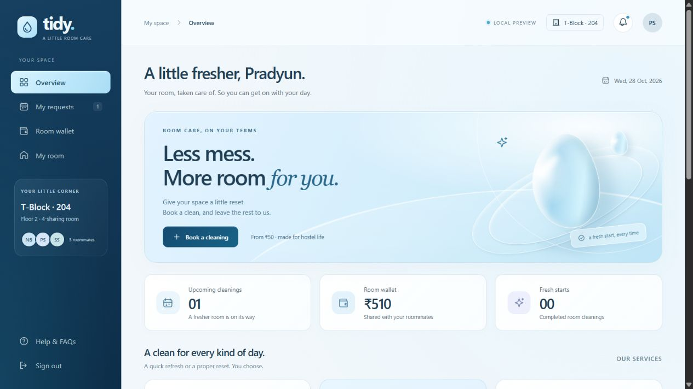

# Tidy · a little room care

A working localhost app for VIT hostel room cleaning. Flask + SQLite, with a responsive, dependency-free HTML/CSS/JavaScript interface. All assets are local; no CDN or build step is needed.

A database systems project demonstrating relational tables, foreign keys, joins, SQL views, a transaction ledger, atomic booking/refund operations and persistent storage.



For the database systems presentation, follow **`DATABASE_DEMO.md`**. The staff sidebar's **Database demo** page shows live saved rows, SQL, billing views, PK/FK relationships and integrity checks. `database_schema.sql` and `database_queries.sql` are included for the report.

## Run locally

From this folder in PowerShell:

```powershell
python -m pip install -r requirements.txt
python app.py
```

Open **http://127.0.0.1:5000**. You can also double-click `start.cmd`. Keep the server terminal open while using the app; press Ctrl+C to stop it. Python 3.10 or newer is required. The app was tested here on Python 3.14 and Flask 3.1.3.

If port 5000 is occupied, stop the previous Tidy server or run:

```powershell
$env:PORT = '5001'
python app.py
```

Then open http://127.0.0.1:5001.

## Try it

The sign-in page has **Explore the student demo** and **Explore the staff demo** buttons. Or use these credentials:

| Account | Email | Password |
| --- | --- | --- |
| Student · Pradyun | pradyun@vit.ac.in | pass123 |
| Roommate · Bhuvan | bhuvan@vit.ac.in | pass123 |
| Roommate · Shaurya | shaurya@vit.ac.in | pass123 |
| Hostel staff | staff@vit.ac.in | pass123 |

The three students share **T-Block, room 204**. New databases begin with ₹500 demo credits. The room code is available under **My room** (initial demo code: `TIDY204`).

1. Sign in as a student and choose **Book a cleaning**.
2. Select a service, available time and optional cleaner preference / access note.
3. Review the charge and confirm. A cleaner in the room's block is assigned, and the shared wallet is charged once.
4. See **My requests**, request details, activity notifications, **Room wallet** and **My room**.
5. Cancel a scheduled request at least 5 minutes before the slot for a full refund.
6. Sign in as staff to see all requests. On the scheduled day, start a cleaning up to 15 minutes before the slot, then mark it complete. For class presentations, **Start now · demo** explicitly bypasses the time window and records a demo note; it is staff-only and can be disabled with `TIDY_DEMO_MODE=0`. In-progress requests may be completed immediately for a quick demo.
7. Return as a student to rate the completed cleaning once for the room.

Students can create local accounts with an email ending in `vit.ac.in` or `vitstudent.ac.in` and a password of at least 8 characters. New rooms get a zero-balance wallet; add demo credits to try a booking. Joining an existing room requires its private room code. Room capacity and duplicate accounts are checked. Email ownership is not verified in this prototype.

## Booking rules

- All schedule dates and times are **IST (Asia/Kolkata)**, regardless of browser timezone.
- Cleaning hours: **9:00 am–6:00 pm**, every day. Bookings must finish by 6:00 pm.
- Start times every 30 minutes, at least 10 minutes ahead, up to 14 days out.
- Services: Everyday clean (₹50 / 30 min), Room refresh (₹90 / 45 min), Deep clean (₹150 / 60 min).
- Availability checks the room, cleaner, block and service duration. Confirmation rechecks under a database write lock, so two roommates cannot double-book a room.
- Student cancellation closes 5 minutes before the slot. Staff may cancel an assigned request with a full refund. In-progress and completed cleanings cannot be cancelled.
- Student views are restricted to their room. Students cannot perform staff actions.
- Open dashboards check for updates every 20 seconds. Forms and open dialogs are left undisturbed; refresh or reopen details to see the newest state.
- Staff must explicitly complete or cancel requests. Dates passing alone do not mark work complete.

## Local data and scope

The app creates `hostel_cleaning.db` and `.session-key` beside `app.py`. Accounts, requests, wallet entries, ratings and activity history survive restarts. Existing databases from the original app are migrated without discarding records; original plaintext student passwords are converted to hashes. Initialisation is idempotent.

The runtime database, session key, environment files and local backups are excluded from Git. A fresh checkout creates its own database with demo accounts on first run. Back up the database with SQLite's backup API while the app is running, or stop the app before copying database files.

This is an independent **local prototype**, not an official VIT service. Demo top-ups do not take payments. Campus identity verification, real payment processing, email/SMS/push delivery, password recovery and room reassignment are not connected. Registration checks email format; it does not verify ownership. Hostel blocks and cleaner teams are demo fixtures. Default demo accounts and the development server are for localhost use only.

Passwords are hashed, API writes require a session CSRF token, sessions use HTTP-only/SameSite cookies, user text is escaped before rendering, and wallet/booking writes are transactional. The server binds to `127.0.0.1` with debug mode disabled.

## Verify

```powershell
python -m unittest discover -s tests -v
node --check static/app.js
```

API tests use temporary databases and a fixed clock. They cover authentication, CSRF, account creation, room privacy, service/slot validation, cross-block assignment, shared balances, concurrent bookings, refunds, status transitions, feedback, persistence and migration from the original schema.

Browser QA also exercised sign-in, the complete booking/cancellation/refund flow, demo top-ups, mobile navigation and staff access. See `QA.md` for the final validation record.

## Files

- `app.py` — Flask app factory, database migration and API.
- `index.html` — minimal application shell.
- `static/app.js` — account screens, student/staff dashboards and booking flow.
- `static/style.css` / `static/components.css` — responsive layout and shared components.
- `static/water.css` — ocean-blue palette, glass surfaces, water illustration styling and reduced-motion-aware ripple animation.
- `tests/test_app.py` — isolated API integration tests.

The water illustration uses CSS. Its component (`waterArt`) can later be replaced with a Blender render or a 3D viewer without changing the booking flow.
